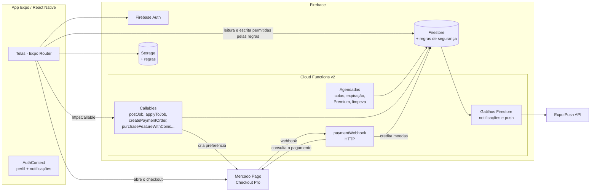

# ProConecta — marketplace de serviços (Expo + Firebase)

App mobile que conecta **quem precisa de um serviço** (contratante) a **profissionais autônomos** (eletricistas, encanadores, designers, professores...). O contratante publica vagas e conversa com os profissionais; o profissional monta o perfil com profissões, portfólio e avaliações, se candidata às vagas e pode assinar o plano **Premium** para aparecer em destaque.

Tudo gira em torno de uma **carteira de moedas**: publicar vaga, destacar, estender o prazo, se candidatar e assinar o Premium custam moedas, que são compradas pelo **Mercado Pago**. A lógica de cobrança roda em **Cloud Functions**, nunca no app.

> **Sobre esta versão:** versão anonimizada de um sistema real que desenvolvi para uma empresa; nomes, marca, domínios, conteúdo proprietário e dados foram substituídos por fictícios.

**English summary:** React Native (Expo SDK 53, Expo Router, TypeScript) service marketplace backed by Firebase: Auth, Firestore with hardened security rules, Storage, and 20+ Cloud Functions (v2) for the coin wallet, job posting, applications, premium subscription, scheduled jobs (quota reset, job expiry, subscription renewal, profile-view aggregation, account cleanup), push notifications via Expo and Mercado Pago Checkout Pro with an idempotent webhook. Runs fully offline against the Firebase Emulator Suite with a demo project (`demo-proconecta`) and a seed script, no Google account needed.

---

## Sumário

- [O que o app faz](#o-que-o-app-faz)
- [Arquitetura](#arquitetura)
- [Stack](#stack)
- [Rodar localmente](#rodar-localmente)
- [Contas de demonstração](#contas-de-demonstração)
- [Roteiro para testar](#roteiro-para-testar)
- [Integrações](#integrações)
- [Segurança](#segurança)
- [Estrutura do repositório](#estrutura-do-repositório)
- [Variáveis de ambiente](#variáveis-de-ambiente)
- [Decisões técnicas](#decisões-técnicas)

---

## O que o app faz

### Conta e perfil

| Módulo | O que faz |
|---|---|
| **Cadastro e login** | E-mail e senha (Firebase Auth), indicador de força da senha, CPF validado (dígitos verificadores) e único por conta, recuperação de senha por e-mail. |
| **Onboarding** | O usuário escolhe ser **contratante** ou **profissional** e completa o perfil (telefone, cidade e UF pela API de localidades do IBGE, profissão e bio). |
| **Perfil** | Foto, dados de contato, links profissionais (Premium), localização, gráfico de visualizações do perfil nos últimos 7 dias. |
| **Profissões** | Várias profissões por profissional, com nível (Iniciante a Especialista) e uma marcada como principal. Dá para sugerir uma profissão nova. |
| **Portfólio** | Galeria de imagens do profissional (Firebase Storage). |
| **Avaliações** | Nota de 1 a 5 com comentário; quem avaliou pode editar ou apagar. |
| **Bloqueio** | Bloquear e desbloquear usuários, com aviso no chat. |
| **Desativar conta** | A conta fica desativada por 30 dias (pode ser reativada); depois disso uma função agendada apaga os dados e o usuário do Auth. |

### Vagas

| Módulo | O que faz |
|---|---|
| **Publicar vaga** | Título, descrição, categoria, local, orçamento ou "a combinar", duração (1 a 30 dias) e destaque. O custo é calculado pela tabela `app_config/costs`; há uma cota semanal de vagas grátis. |
| **Mural de vagas** | Vagas abertas, com as destacadas primeiro. Qualquer usuário favorita; só o autor edita e encerra. |
| **Candidatura** | O profissional envia uma carta de apresentação. Usa a cota semanal grátis ou paga em moedas (Premium tem desconto). O autor da vaga é notificado e vê a lista de candidatos. |
| **Expiração** | Uma função agendada marca como expiradas as vagas vencidas. |

### Comunicação

- **Chat 1:1** em tempo real: texto, imagens e vídeos da galeria, documentos, áudio gravado no app, resposta a uma mensagem, apagar "para mim" ou "para todos".
- **Notificações** no app (candidatura, mensagem, avaliação, carteira) e **push** pelo serviço de push do Expo. Tela de preferências por tipo de notificação.

### Carteira e Premium

- **Pacotes de moedas** (com bônus) comprados pelo Mercado Pago.
- **Premium**: 120 moedas por 30 dias, com renovação automática pela carteira enquanto houver saldo. Dá destaque na home e na lista de profissionais Premium, mais cotas grátis e desconto na candidatura.

---

## Arquitetura



**Regra de ouro:** tudo que envolve moedas, cotas, status de vaga ou Premium acontece **só nas Cloud Functions**, dentro de transações do Firestore. As regras de segurança impedem o app de gravar esses campos diretamente.

**Fluxo de compra de moedas**

1. O app chama `createPaymentOrder` com o id do pacote. A função lê o preço no Firestore (o app nunca manda o valor) e cria a preferência no Mercado Pago com o `uid` em `external_reference`.
2. O app abre o checkout no navegador interno (`expo-web-browser`).
3. O Mercado Pago chama `paymentWebhook`. A função confere a assinatura (se configurada), **consulta o pagamento na API** do Mercado Pago, confere status e valor, e credita as moedas numa transação. O id do pagamento vira o id do documento em `transactions`, então o mesmo aviso nunca credita duas vezes.
4. A notificação de recarga dispara o push.

---

## Stack

**App:** Expo SDK 53, React Native 0.79, React 19, TypeScript 5.8, Expo Router 5 (rotas tipadas), Firebase JS SDK 12 (Auth com persistência em AsyncStorage, Firestore, Storage, Functions), expo-notifications, expo-image-picker, expo-document-picker, expo-audio, expo-video, expo-web-browser, react-native-reanimated, máscaras com react-native-mask-text.

**Backend:** Firebase Cloud Functions v2 (Node.js 22, TypeScript), firebase-admin, SDK oficial do Mercado Pago, Cloud Scheduler (funções `onSchedule`), Secret Manager para o token do Mercado Pago.

**Ambiente local:** Firebase Emulator Suite (Auth, Firestore, Functions, Storage) com o projeto de demonstração `demo-proconecta`.

---

## Rodar localmente

Não precisa de conta Google nem de projeto Firebase: tudo roda nos **emuladores** com um projeto `demo-*`, que o Firebase garante nunca acessar recursos reais.

### Pré-requisitos

- Node.js 22+
- Java 21+ (os emuladores do Firestore e do Storage rodam na JVM)
- Para abrir o app: um emulador Android / simulador iOS, ou um celular com o **Expo Go compatível com o SDK 53** (no emulador Android e no simulador iOS, o `expo start` instala a versão certa do Expo Go sozinho)

A CLI do Firebase **não** precisa estar instalada globalmente: os scripts usam `npx firebase-tools@14`.

### 1. Instalar

```bash
git clone https://github.com/vitormouramaker/marketplace-servicos-expo-firebase.git
cd marketplace-servicos-expo-firebase
npm ci
npm --prefix functions ci
```

### 2. Subir os emuladores (terminal 1)

```bash
npm run emulators
```

Compila as Cloud Functions e sobe Auth (9099), Firestore (8080), Functions (5001) e Storage (9199). A interface dos emuladores fica em http://localhost:4000.

Sem `functions/.secret.local`, o emulador avisa que não conseguiu ler o segredo `MERCADOPAGO_ACCESS_TOKEN` do Secret Manager. É esperado: a compra de moedas cai no modo demonstração. As funções agendadas (`onSchedule`) aparecem como ignoradas, porque o emulador não as executa.

### 3. Popular com dados de demonstração (terminal 2)

```bash
npm run seed:demo
```

Cria as [contas de demonstração](#contas-de-demonstração), categorias, profissões, pacotes de moedas, custos, vagas, uma candidatura, uma conversa e avaliações. O script só roda contra os emuladores e com projeto `demo-*`, e recusa `NODE_ENV=production`.

### 4. Abrir o app (terminal 3)

```bash
npm start
```

- **Emulador Android:** tecle `a`. O app já aponta para `10.0.2.2` (o endereço da sua máquina visto de dentro do emulador).
- **Simulador iOS:** tecle `i`. O app usa `localhost`.
- **Celular com Expo Go:** leia o QR code. Antes, crie um `.env` com o IP da sua máquina na rede local, para o celular alcançar os emuladores:

  ```bash
  cp .env.example .env
  # edite: EXPO_PUBLIC_EMULATOR_HOST=192.168.0.10  (o IP da sua máquina)
  ```

### Sem chaves externas, tudo funciona

| Sem... | Comportamento |
|---|---|
| Projeto Firebase real | O app usa `demo-proconecta` e os emuladores. |
| `MERCADOPAGO_ACCESS_TOKEN` | No emulador, a compra de moedas entra em **modo demonstração**: a função credita o pacote sem cobrança e o app mostra um aviso. Fora do emulador, a compra é recusada com uma mensagem clara. |
| `EAS_PROJECT_ID` | O registro de push é ignorado. As notificações continuam aparecendo dentro do app. |
| Servidor de e-mail | O emulador do Auth não envia e-mail: o link de "Esqueci minha senha" aparece no terminal dos emuladores. |

### Usar um projeto Firebase seu (opcional)

1. Crie um projeto no console do Firebase, ative Authentication (e-mail/senha), Firestore e Storage, e registre um **app da Web**.
2. Preencha as variáveis `EXPO_PUBLIC_FIREBASE_*` no `.env` e use `EXPO_PUBLIC_USE_FIREBASE_EMULATORS=false`.
3. Publique regras, índices e funções: `npx firebase-tools@14 deploy --project <seu-projeto>` (as Cloud Functions exigem o plano Blaze).
4. Os documentos de catálogo (`categories`, `professions`, `coin_packages`, `app_config/costs`) são criados pelo console, porque as regras bloqueiam escrita pelo app.

---

## Contas de demonstração

Criadas por `npm run seed:demo`. Senha de todas: **`Demo@1234`**. Existem só nos seus emuladores locais.

| Perfil | E-mail | Situação |
|---|---|---|
| Contratante | `contratante@demo.proconecta.test` | 200 moedas, 3 vagas publicadas, conversa com o profissional |
| Profissional | `profissional@demo.proconecta.test` | Eletricista, 40 moedas, já se candidatou a uma vaga |
| Profissional Premium | `premium@demo.proconecta.test` | Designer, Premium por 30 dias, 300 moedas |
| Profissional | `encanador@demo.proconecta.test` | Encanador, carteira zerada |

## Roteiro para testar

1. Entre como **contratante**. Na home, veja categorias e profissionais em destaque. Abra a vaga "Instalar 6 tomadas..." e veja o candidato.
2. Abra o chat com o profissional e envie uma mensagem (texto, imagem ou áudio).
3. Publique uma vaga nova com destaque e 3 dias: o custo aparece antes de publicar e sai da carteira.
4. Em outra sessão (ou outro simulador), entre como **profissional**. Veja a notificação da mensagem, candidate-se a outra vaga e confira a cota grátis sendo usada.
5. Na **Carteira**, compre um pacote: sem token do Mercado Pago, o modo demonstração credita as moedas na hora.
6. Assine o **Premium** pelo painel do profissional (120 moedas) e veja o perfil subir para a lista Premium.
7. Avalie um profissional, depois edite a avaliação.
8. Abra a interface dos emuladores (http://localhost:4000) para acompanhar documentos, usuários e logs das funções.

---

## Integrações

### Mercado Pago (Checkout Pro)

- `createPaymentOrder` (callable) cria a preferência com preço lido do Firestore, PIX liberado, boleto excluído e expiração de 30 minutos. `back_urls` e `notification_url` vêm de variáveis de ambiente.
- `paymentWebhook` (HTTP) valida a assinatura `x-signature` quando `MERCADOPAGO_WEBHOOK_SECRET` está definido, busca o pagamento na API (o corpo do aviso nunca é usado como verdade), confere se o valor pago cobre o preço do pacote e credita de forma idempotente.
- O token fica no **Secret Manager** (`MERCADOPAGO_ACCESS_TOKEN`). Para testar com o sandbox no emulador, use `functions/.secret.local` (veja `functions/.secret.local.example`).

### Push (Expo)

- O app registra o token de push do Expo num documento privado do usuário.
- `sendPushOnNewNotification` dispara a cada notificação criada e envia pela API de push do Expo.

### IBGE

- Estados e cidades no cadastro e na publicação de vagas vêm da API pública de localidades do IBGE.

---

## Segurança

Esta versão traz as regras do Firestore e do Storage revisadas:

- **Campos do servidor protegidos:** o usuário edita o próprio perfil, mas não pode gravar `walletBalance`, `isPremium`, `premiumExpiresAt`, cotas, contadores, favoritos, bloqueios nem o status da conta. Esses campos só mudam pelas Cloud Functions. O tipo de perfil só pode ser `professional` ou `contractor`.
- **Dados pessoais privados:** CPF e tokens de push ficam em `users/{uid}/private/account`, legível só pelo dono. Perfis exigem login para leitura.
- **CPF único sem vazar:** `cpf_references` só aceita *criar* o documento com o próprio uid; ninguém lê nem sobrescreve. Um CPF já usado faz o cadastro falhar e a conta recém-criada é apagada.
- **Chat fechado:** só participantes listam, leem e escrevem mensagens; a lista de participantes não pode ser trocada; o id da sala é determinístico.
- **Storage:** a mídia do chat é autorizada pela sala no Firestore (regra entre serviços), não por metadados enviados pelo cliente. Arquivos não podem ser sobrescritos e há limite de tamanho.
- **Avaliações:** assinadas com o uid de quem avalia, nota inteira de 1 a 5, edição restrita a nota e comentário.
- **Cloud Functions:** toda callable exige login e valida a entrada (duração da vaga, tamanhos de texto, tipos). Débitos e créditos acontecem em transações.

---

## Estrutura do repositório

```
marketplace-servicos-expo-firebase/
├── app/                        # rotas (Expo Router)
│   ├── (auth)/                 # login, cadastro, recuperar senha
│   └── (app)/                  # área logada: home, vagas, chat, perfil, carteira...
├── src/
│   ├── screens/                # uma tela por arquivo (as rotas só reexportam)
│   ├── components/             # common, chat, home, profile, premium
│   ├── contexts/               # AuthContext (perfil, push, notificações) e ModalContext
│   ├── services/               # firebaseConfig (emuladores), storage, IBGE, categorias
│   ├── styles/                 # tema
│   └── utils/                  # validadores (CPF, senha), formatadores, datas
├── functions/
│   ├── src/index.ts            # todas as Cloud Functions
│   └── scripts/seed-demo.js    # seed de demonstração (só emulador)
├── assets/images/              # ícones neutros desta versão
├── firestore.rules             # regras do Firestore
├── storage.rules               # regras do Storage
├── firestore.indexes.json      # índices compostos
├── firebase.json               # Firebase + portas dos emuladores
├── .firebaserc                 # projeto padrão: demo-proconecta
├── app.config.js               # configuração do Expo (ids via env)
└── eas.json                    # perfis de build do EAS
```

---

## Variáveis de ambiente

App (`.env`, veja [`.env.example`](.env.example)). Nenhuma é obrigatória localmente.

| Variável | Para quê |
|---|---|
| `EXPO_PUBLIC_FIREBASE_*` | Configuração de um projeto Firebase real (sem elas: `demo-proconecta`) |
| `EXPO_PUBLIC_USE_FIREBASE_EMULATORS` | Força (`true`) ou desliga (`false`) os emuladores |
| `EXPO_PUBLIC_EMULATOR_HOST` | Host dos emuladores visto pelo app (IP da máquina para celular físico) |
| `EAS_PROJECT_ID`, `EXPO_OWNER` | Projeto no EAS (liga o push do Expo) |
| `ANDROID_PACKAGE`, `IOS_BUNDLE_IDENTIFIER` | Identificadores do app para build nativo |
| `GOOGLE_SERVICES_JSON` | Caminho do `google-services.json` do seu projeto (build Android com FCM) |

Cloud Functions (`functions/.env` e `functions/.secret.local`, veja os `.example`). Todas opcionais.

| Variável | Para quê |
|---|---|
| `MERCADOPAGO_ACCESS_TOKEN` | Token do Mercado Pago (segredo) |
| `MERCADOPAGO_WEBHOOK_SECRET` | Liga a validação da assinatura do webhook |
| `MERCADOPAGO_WEBHOOK_URL` | `notification_url` enviada na preferência |
| `PAYMENT_BACK_URL_SUCCESS` / `_FAILURE` / `_PENDING` | Retorno do checkout |

---

## Decisões técnicas

- **Cobrança só no servidor:** o app nunca calcula o que é debitado. As callables leem a tabela de custos no Firestore e debitam dentro de `runTransaction`, com as regras bloqueando escrita direta nos campos da carteira.
- **Webhook idempotente:** o id do pagamento vira o id do documento em `transactions`, conferido dentro da mesma transação que credita as moedas.
- **Funções agendadas em lotes:** cotas semanais, expiração de vagas, renovação do Premium e agregação de visualizações percorrem coleções inteiras; as escritas são divididas em lotes de até 450 operações (o limite do Firestore é 500).
- **Visualizações agregadas:** cada visita vira um documento (com deduplicação de 24 h por visitante) e uma função diária consolida os últimos 7 dias no perfil, para o gráfico ler um único documento.
- **Premium com ordem aleatória:** cada Premium recebe um campo `random`, e a home busca a partir de um ponto aleatório, distribuindo a exposição entre os assinantes.
- **Ambiente local sem conta:** projeto `demo-*`, emuladores ligados automaticamente pelo app e seed que se recusa a rodar fora deles.

---

Autor: [@vitormouramaker](https://github.com/vitormouramaker)

Este código é exibido como portfólio. Ele não tem licença de uso aberta: todos os direitos são reservados.
